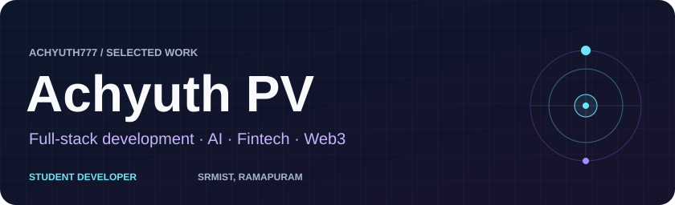
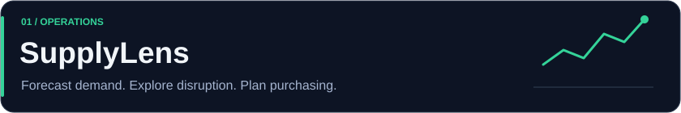
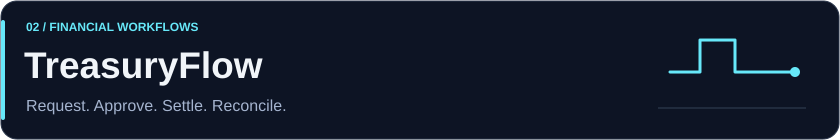
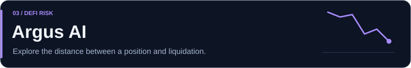
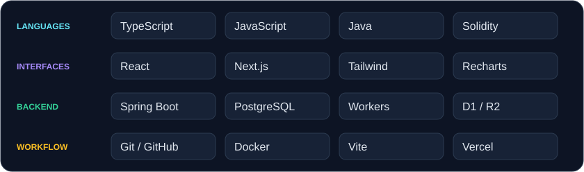

  
  

  <a href="#what-im-building">Projects</a> ·
  <a href="#technologies-i-work-with">Tech stack</a> ·
  <a href="#github-in-motion">GitHub stats</a> ·
  <a href="#lets-connect">Connect</a>

I build software around decisions: what to reorder, when a payment can proceed, and how much risk a position carries.

I'm studying **B.Tech Information Technology at SRMIST, Ramapuram**, and developing my skills through full-stack projects in operations, fintech, and Web3.

## What I'm building

[SupplyLens](#01--supplylens) · [TreasuryFlow](#02--treasuryflow) · [Argus AI](#03--argus-ai)

Three projects exploring how to turn complex information into a useful next step.

### 01 / SupplyLens

**An inventory workspace that connects demand forecasts to purchasing decisions.**

For operations teams, knowing stock is running low is only part of the problem. SupplyLens explores what to order when demand changes or suppliers fall behind.

- Forecasts demand with exponential smoothing and calculates replenishment using lead times, safety stock, and incoming orders.
- Models supplier delays and demand shocks, showing inventory runway and potential shortfalls.
- Moves purchase orders from draft to receipt, with duplicate-receipt guards and revision-checked database writes.

*Database-backed MVP with synthetic starting data; external supply-chain integrations are future work.*

**Built with:** TypeScript, React, Recharts, Vinext, Cloudflare Workers/D1, Zod.

[Repository](https://github.com/Achyuth777/SupplyLens) · [Engineering walkthrough](https://github.com/Achyuth777/SupplyLens/blob/supplylens-demo/PROJECT_EXPLAINED.md)

---

### 02 / TreasuryFlow

**A supplier-payment project built around approvals, traceability, and recovery.**

A payment workflow has to answer more than “did it succeed?” Who approved it, can a retry pay twice, and what happens when settlement finishes but the response never arrives?

- The local Spring Boot/PostgreSQL system uses idempotent requests and Solidity-enforced approval thresholds, due dates, and daily limits.
- Reconciliation checks chain records against the ledger and restores interrupted settlements without issuing a second payment.
- A separate company workspace implements role permissions, invoice approvals, protected PDF attachments, manual payment records, and audit history using D1/R2.

*Educational local EVM settlement; the company workspace records payments made elsewhere. The linked browser demo simulates settlement.*

**Built with:** React, TypeScript, Java, Spring Boot, PostgreSQL, Solidity, Cloudflare D1/R2.

[Repository](https://github.com/Achyuth777/treasuryflow) · [Browser demo](https://treasuryflow-smoky.vercel.app) · [Architecture and boundaries](https://github.com/Achyuth777/treasuryflow/blob/main/docs/FULLSTACK.md)

---

### 03 / Argus AI

**A Solana DeFi risk simulator for exploring how positions respond to market shocks.**

I'm interested in the space between seeing a position's health factor and understanding what to do about it. The documented V2 makes those trade-offs explorable.

- Calculates modeled health factors, liquidation buffers, and repayment or collateral needed to reach a target health factor.
- Simulates protection rules with balance, spending, expiry, and manual-approval checks.
- Generates deterministic portfolio explanations; a separate server-side Gemini endpoint provides an experimental AI integration.

*V2 uses demo positions. Live lending data and autonomous execution are not enabled. WATCH → PREDICT → SIMULATE → PROTECT is the direction, not a claim of completed automation.*

**Built with:** TypeScript, Next.js, React, Tailwind CSS, Solana Wallet Adapter; optional Gemini API.

[V2 repository](https://github.com/Achyuth777/argus-ai) · [V2 simulator demo](https://argus-ai-mu.vercel.app) · [Newer interface prototype](https://github.com/Achyuth777/Argus-Risk-Ai)

---

## A little about me

I enjoy understanding the rules underneath an interface: how inventory changes, how money moves, and what makes a financial position fragile. Full-stack development gives me a way to explore those questions. AI and blockchain are part of that curiosity, alongside product design and the longer-term goal of building a technology business.

## Technologies I work with

View the stack as text

- **Languages:** TypeScript, JavaScript, Java, Solidity
- **Interfaces:** React, Next.js, Tailwind CSS, Recharts
- **Backend:** Spring Boot, PostgreSQL, Cloudflare Workers, D1, R2
- **Tools:** Git, GitHub, Docker, Vite, Vercel

These are tools used across my projects; I'm still building depth in the systems behind them.

## Currently exploring

I'm working on data structures and algorithms, backend architecture, and more reliable full-stack applications. My projects give me concrete questions to follow: handling concurrent updates, recovering from failures, and keeping AI explanations grounded in financial data.

## GitHub in motion

Generated from public GitHub data. [Daily refresh workflow](https://github.com/Achyuth777/Achyuth777/actions/workflows/profile-stats.yml) · [How the numbers work](./PROFILE-VISUALS.md). Streaks use UTC; language shares describe code, not expertise.

## Let's connect

I'd be glad to hear from people building in fintech, developer tools, or applied AI—especially if you have thoughts on the projects above.

[Find me on GitHub](https://github.com/Achyuth777)

<!-- Add verified contact details when ready:
LinkedIn: YOUR_LINKEDIN_URL
Email: YOUR_PUBLIC_EMAIL
Portfolio: YOUR_PORTFOLIO_URL
X: YOUR_X_PROFILE_URL
-->
